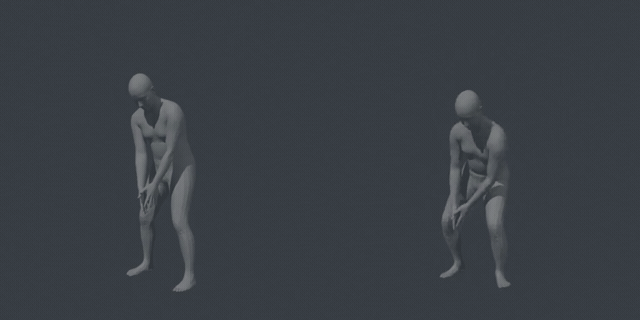

# Moving Like Goofy

**Teaching any character a cartoon's way of moving, from 71 example clips.**

Omar Alromaihi · Technical report, October 2026 · work in progress

[**Project page**](https://omarintern.github.io/moving-like-goofy/)

*Left: the original input, a golf swing from a generated video of a person, with the body motion read off it. Right: the Goofy-style output, the same swing with his bearing. One clock.*

## What this is

A project page, not a paper and not software to install. It shows a motion model that learned Goofy's way of moving from his own films: 71 short clips, 195 seconds of footage from the Disney shorts of the 1940s and early 1950s, each paired with a generated plain performance of the same action, trained for 103 minutes on one GPU. The clips were chosen by hand: scene detection on 45 of his films found 3,812 scenes and shots, 657 of them were judged by hand, and 64 were kept, giving the 71 training pairs and four held out to check the model. After that, any plain performance comes out as his. The page shows the results as 3D figures beside the original input. It also shows results from the previous version of the cleanup, painted back into the person's own footage by a video model and performed by a humanoid robot in a physics simulation.

## What is on the page

- **Results.** Pairs on one clock: the original input, a plain performance of the action, its source named under each clip, beside the Goofy-style output, the same action with his bearing. A shot put, a golf swing, a wait at a bus stop as the bus arrives, a ballet phrase. Then a kick and a skid through three stages of the model, trained on 17, 40 and 71 example clips.
- **In the shot.** A skid and a kick rendered into their own footage by a video model, footage that is itself generated by a different video model with the person's body motion read off it, each shown three ways: the original input, the output at the person's pace, and the same output a quarter faster.
- **On a robot.** A walk from his own films, kept out of training, on a Unitree G1 in simulation, with the original input, a generated plain version of the walk, on the same robot beside it.
- **Method** and **How it is made.** From his films to a fit, the pairs, the training, and the single solve that keeps the output on the person's path and footing.
- **What's next.** What the training clips hold and where his manner shows most, two ways to grow the data, finer phases, and better pairs.

Some captions point at moments where his manner shows. Each time is a link: a click sends every panel of that clip to one second before the moment and plays it.

## How it works, in short

The model builds on [STyMo](https://doi.org/10.1145/3811356) (Ponton, Winkler, Kavan, Ye and Kadlecek, SIGGRAPH 2026): the split of a style into a posture and a way of moving through it is STyMo's. Here the posture is one fixed pose, measured from his fits and frozen by hand, then laid onto the plain performance before the model, at half strength for inputs read off video; his own clips keep their own posture. The way of moving is the learned part: the difference from the person's motion to his, over windows of 32 frames, about a second around each frame, learned by a small transformer from the 71 pairs, his clip beside a plain performance generated by a motion model from a one-line description. The model also reads a phase label for each moment of the person's motion, from [MoMask](https://openaccess.thecvf.com/content/CVPR2024/html/Guo_MoMask_Generative_Masked_Modeling_of_3D_Human_Motions_CVPR_2024_paper.html)'s pretrained motion tokenizer, and trains with a foot-contact term that penalizes a planted foot that lifts, sinks or slides. Around that, this project adds the character's manner learned from his films rather than from motion capture, the extraction and checks that make old film usable as training data, a final pass that keeps him on the person's path and footing, and the two uses after the motion: the video model and the robot.

## What is in this repository

The page and its clips. Nothing to build or run.

- `index.html`: the page.
- `media/`: the 17 videos and 6 posters it plays, and the 9 pictures of the Method figure.

Open `index.html` in a browser, or visit the project page.

## Credits

Goofy is a Disney character; his films are the Disney shorts of the 1940s and early 1950s, used here as the subject of study.

His fits: [FlowHMR](https://arxiv.org/abs/2610.03691) (Wang et al., "FlowHMR: Physically Plausible Motion Capture from Video", 2026) and [GVHMR](https://doi.org/10.1145/3680528.3687565) (Shen et al., "World-Grounded Human Motion Recovery via Gravity-View Coordinates", SIGGRAPH Asia 2024), on the [SMPL-X](https://openaccess.thecvf.com/content_CVPR_2019/html/Pavlakos_Expressive_Body_Capture_3D_Hands_Face_and_Body_From_a_CVPR_2019_paper.html) body model (Pavlakos et al., "Expressive Body Capture: 3D Hands, Face, and Body from a Single Image", CVPR 2019).

The neutrals: [Kimodo](https://arxiv.org/abs/2603.15546) (Rempe et al., NVIDIA, "Kimodo: Scaling Controllable Human Motion Generation", 2026) and [HY-Motion 1.0](https://arxiv.org/abs/2512.23464) (Tencent Hunyuan, "HY-Motion 1.0: Scaling Flow Matching Models for Text-To-Motion Generation", 2025).

The phase labels: [MoMask](https://openaccess.thecvf.com/content/CVPR2024/html/Guo_MoMask_Generative_Masked_Modeling_of_3D_Human_Motions_CVPR_2024_paper.html) (Guo et al., "MoMask: Generative Masked Modeling of 3D Human Motions", CVPR 2024), trained on [HumanML3D](https://openaccess.thecvf.com/content/CVPR2022/html/Guo_Generating_Diverse_and_Natural_3D_Human_Motions_From_Text_CVPR_2022_paper.html) (Guo et al., "Generating Diverse and Natural 3D Human Motions from Text", CVPR 2022), whose motions come from AMASS.

New inputs: the shot put from AMASS's Eyes Japan set ([AMASS](https://openaccess.thecvf.com/content_ICCV_2019/html/Mahmood_AMASS_Archive_of_Motion_Capture_As_Surface_Shapes_ICCV_2019_paper.html): Mahmood et al., "AMASS: Archive of Motion Capture as Surface Shapes", ICCV 2019; [Eyes Japan](https://mocapdata.com/): mocapdata.com, Eyes, JAPAN Co. Ltd.); the ballet from HY-Motion 1.0; the person videos for the golf swing, bus stop, kick and skid generated with [Seedance 1.5 pro](https://seed.bytedance.com/en/seedance1_5_pro) (ByteDance) and read with GVHMR.

The model builds on [STyMo](https://doi.org/10.1145/3811356): Ponton, Winkler, Kavan, Ye and Kadlecek, "STyMo: Fast and Controllable Few-Shot Motion Style Transfer", SIGGRAPH 2026 ([project page](https://joseluisponton.com/stymo-project-page/)).

The video model: [Wan 2.7](https://www.alibabacloud.com/help/en/model-studio/wan-video-editing-api-reference) (Alibaba).

The robot: the [Unitree G1](https://www.unitree.com/g1), under NVIDIA's [GEAR-SONIC](https://doi.org/10.1126/scirobotics.aed4592) balance controller (Luo et al., "SONIC: Supersizing motion tracking for natural humanoid whole-body control", Science Robotics 2026), the motions mapped onto it with [GMR](https://arxiv.org/abs/2510.02252) (Araujo et al., "Retargeting Matters: General Motion Retargeting for Humanoid Motion Tracking", 2025), simulated in [MuJoCo](https://mujoco.org/).

## To refer to this page

Omar Alromaihi. *Moving Like Goofy: teaching any character a cartoon's way of moving, from 71 example clips.* Technical report, October 2026. https://omarintern.github.io/moving-like-goofy/

Omar Alromaihi, 2026.
